<div align="center">
  
  <h1>Sophon</h1>
  <p><strong>面向授权安全测试的智能 Agent 工作台</strong></p>

  
  
  
  
  
</div>

<p align="center">
  <a href="#zh-cn">简体中文</a>
  |
  <a href="#english">English</a>
</p>

<details id="zh-cn" name="language" open>
<summary><strong>简体中文</strong></summary>

## 项目简介

Sophon 是一个面向授权安全测试、代码审计和攻防演练的智能 Agent 工作台。平台将系统 Agent、可选任务模板、技能、项目上下文、工具执行、证据、漏洞审核、复测和报告输出整合到同一工作流中。

运行时会根据任务复杂度组织 Agent 协作：

- **主 Agent**：面向用户理解目标、汇总态势、下发意图和审核结果。
- **Planner**：读取项目图谱、事实、漏洞和运行状态，将未覆盖方向转化为可验证假设。
- **Worker**：领取单一假设，在授权范围内执行测试、收集证据并写回结果。
- **系统 Agent**：负责安全策略、漏洞审核、漏洞编写、复测和报告等独立职责。

Sophon 的目标不是让模型无限调用扫描器，而是让每次测试具备明确范围、真实证据、审核记录和可复现结论。

> [!WARNING]
> Sophon 仅允许用于本组织拥有或控制的系统，以及已获得目标所有者明确书面授权的安全测试、代码审计和防御演练。严禁用于未授权访问、扫描、利用、干扰、数据收集或数据留存。使用者对全部操作及后果负责。

## 界面预览

| 仪表盘 | 对话与多 Agent 过程 | 项目管理 |
|:---:|:---:|:---:|
| [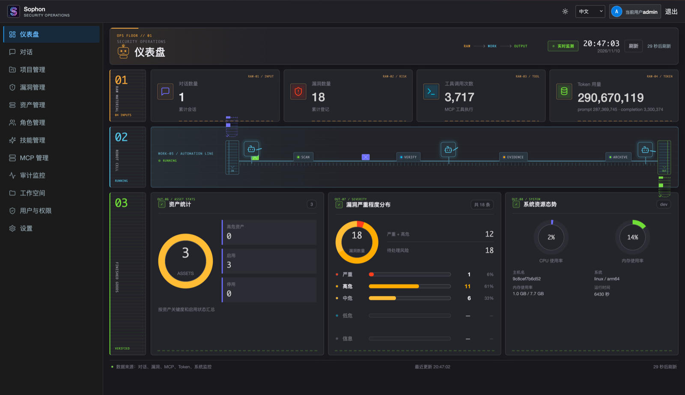](./screenshots/dashboard.png) | [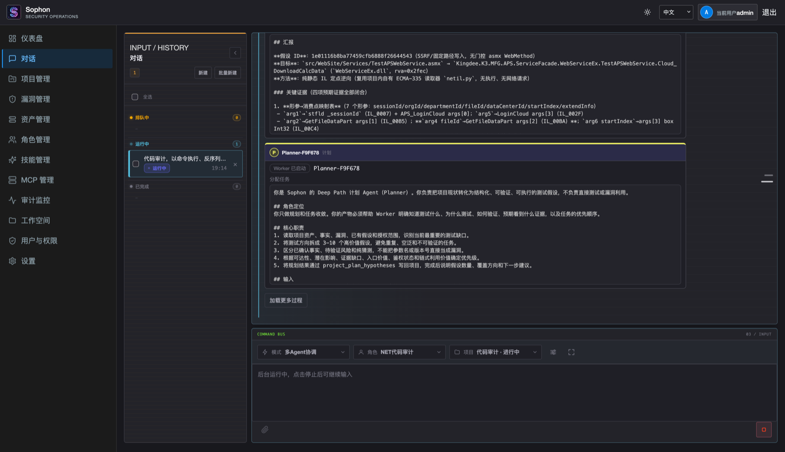](./screenshots/chat.png) | [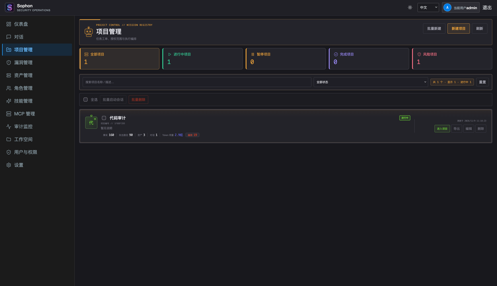](./screenshots/projects.png) |
| **仪表盘** | **对话与多 Agent 过程** | **项目管理** |

| 项目详情 | 资产管理 | 漏洞管理 |
|:---:|:---:|:---:|
| [](./screenshots/project-detail.png) | [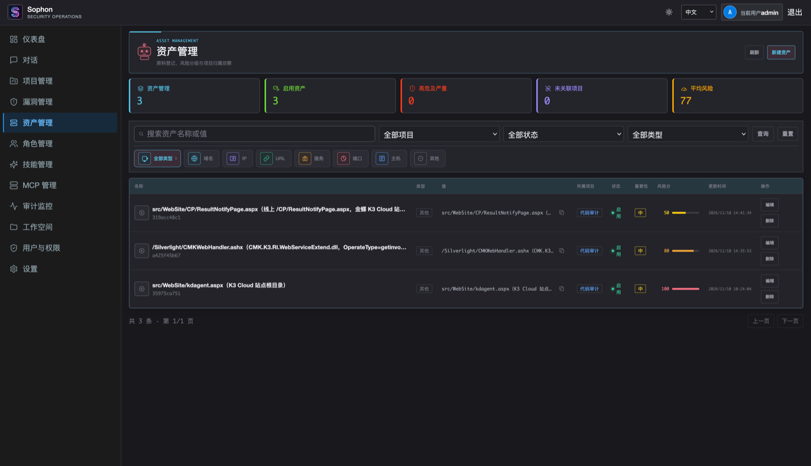](./screenshots/assets.png) | [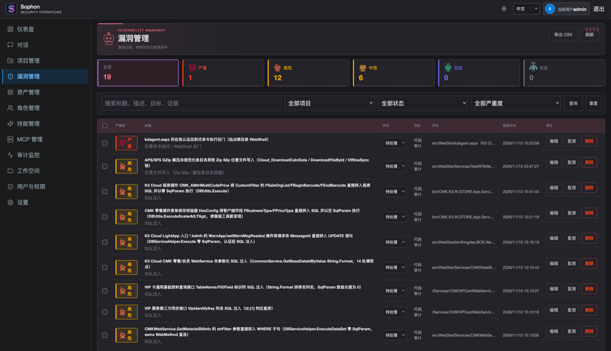](./screenshots/vulnerabilities.png) |
| **项目详情** | **资产管理** | **漏洞管理** |

| Agent 管理 | 技能管理 | MCP 管理 |
|:---:|:---:|:---:|
| [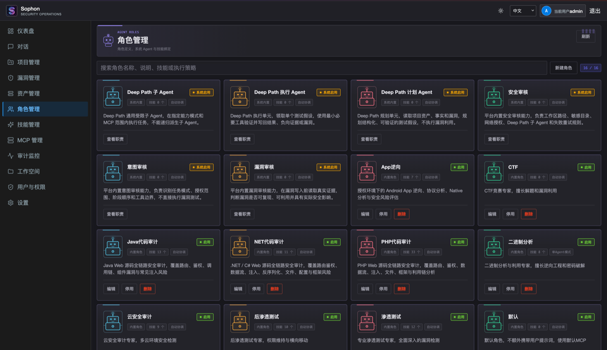](./screenshots/roles.png) | [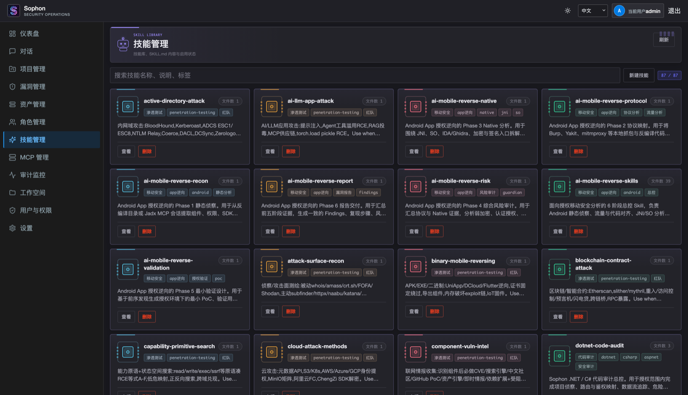](./screenshots/skills.png) | [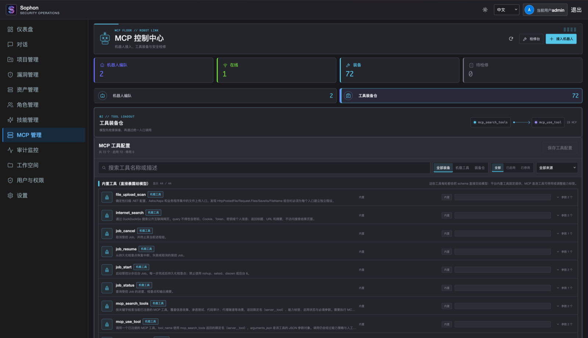](./screenshots/mcp.png) |
| **Agent 管理** | **技能管理** | **MCP 管理** |

| 审计监控 | 工作空间 | 系统设置 |
|:---:|:---:|:---:|
| [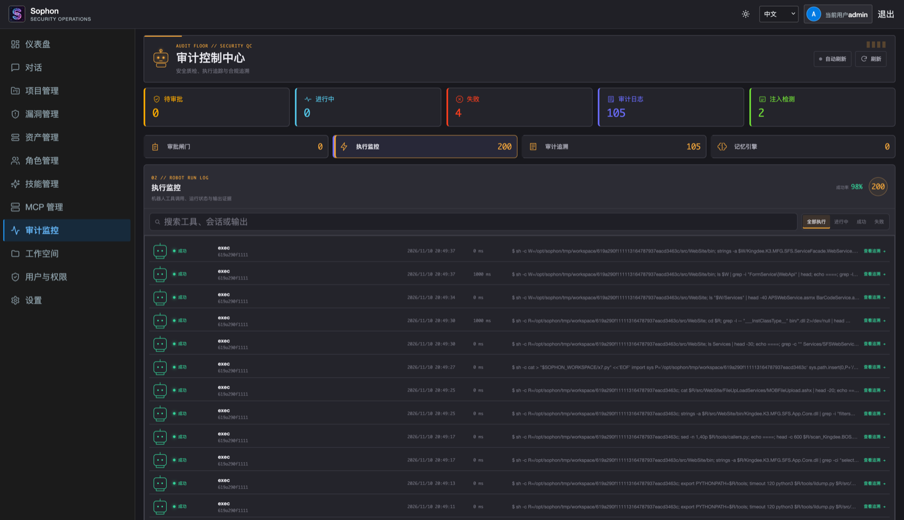](./screenshots/audit.png) | [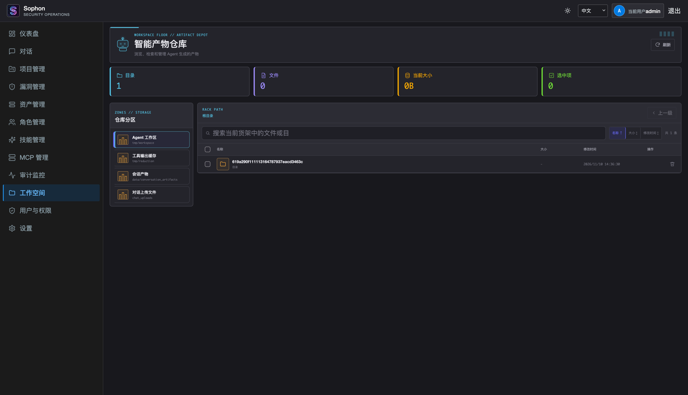](./screenshots/workspace.png) | [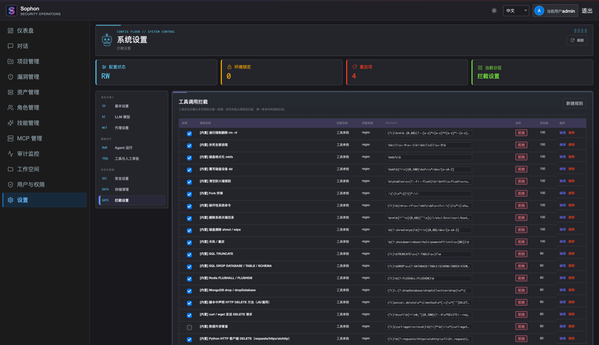](./screenshots/settings.png) |
| **审计监控** | **工作空间** | **系统设置** |

## 核心能力

| 能力 | 说明 |
|---|---|
| 主 Agent | 理解用户目标、调度 Planner/Worker、跟踪状态并汇总结果 |
| 多 Agent | 主 Agent、Planner、Worker 和系统 Agent 按责任协同执行 |
| 系统 Agent 与任务模板 | 系统 Agent 定义运行身份；Task Profile 和 Skill 只提供可选方法 |
| 项目上下文 | 项目、资产、事实、待办意图、证据缺口、测试假设、漏洞、会话和攻击路径统一关联 |
| 证据驱动 | 漏洞需关联工具输出、请求响应、源码位置或可复现步骤 |
| 安全边界 | Mission Policy、授权范围、路径限制、人工审批和资源预算 |
| MCP 与本地工具 | 支持 MCP 服务、YAML 工具、动态 PATH 和 Agent 自主补齐工具 |
| WebShell 与隧道 | Godzilla 官方协议桥接、Payload Factory 和 suo5 SOCKS5 隧道管理 |
| Tool Catalog | 已审核工具的快速安装、校验、源码构建和版本管理，不限制 Agent 自行下载其他工具 |
| Agent 工具注册表 | 登记 Agent 自己下载或编译的工具，支持会话、项目、全局作用域及环境变量 |
| 智子分身 | 将高并发扫描、脚本执行和工具调用分流到多台 VPS，降低本地资源压力 |
| 代码审计 | 内置 Java、PHP、.NET、二进制和 App 逆向相关能力 |
| 漏洞治理 | 漏洞审核、状态流转、复测、证据引用和报告导出 |
| 审计与 RBAC | 登录审计、工具注册与执行、Agent 状态、Token 用量和路由级权限 |
| 中英文界面 | 简体中文与英文界面，支持明暗主题 |

## 系统架构

```text
浏览器
  │
  ▼
Nginx
  ├── 静态前端资源
  ├── /api 反向代理
  └── SSE 流式响应
        │
        ▼
Go API / Agent Runtime
  ├── SQLite
  ├── Workspace 与附件
  ├── MCP Client
  ├── Tool Catalog
  ├── Agent Tool Registry
  ├── 动态工具 PATH
  ├── Tool Runner / 本地工具执行器
  └── LLM / Embedding API
```

## Agent 与技能上下文

Sophon 不会在每轮对话中加载全部技能正文。默认只注入：

- 系统 Agent 身份与职责
- 可选 Task Profile 的方法提示
- 推荐方法包名称和摘要
- 项目、资产、事实和记忆
- Mission Policy

Task Profile 和 Skill 不改变 Agent 身份、模式、工具或权限。只有模型需要具体执行步骤时，才通过 `read_skill` 加载全局技能正文。

```text
系统 Agent 身份
├── 可选 Task Profile ──────────┐
└── 推荐方法包名称与摘要 ───────┤
                                ├── 初始上下文 → LLM
项目、资产、事实 ───────────────┤
会话摘要与长期记忆 ─────────────┤
Mission Policy ─────────────────┘

LLM ── 需要完整步骤时 ──> read_skill ──> 技能正文
```

## Agent 工具自主补齐

Sophon 不把 Tool Catalog 当作工具白名单。Agent 可以根据实际任务自行下载、解包、编译、安装工具，也可以优先使用 Catalog 中已经审核的固定版本。

完整流程：

```text
发现工具或依赖缺失
  -> tool_probe 检查 PATH、项目/会话工具目录和 Catalog 状态
  -> 使用已有命令、Catalog 快速安装，或自行下载/构建
  -> tool_register 注册命令、参数、环境变量、版本和来源
  -> tool_env_add_path 补充动态 PATH，或直接使用 tool_run
  -> Tool Runner 执行工具并记录审计事件
  -> Agent 继续原任务
```

Agent 可以使用以下工具：

| 工具 | 用途 |
|---|---|
| `tool_probe` | 检查命令、依赖、包管理器、编译器和 Catalog 可用性 |
| `tool_catalog_ensure` | Catalog 有对应工具时快速安装并验证；未收录时继续由 Agent 自行处理 |
| `tool_register` | 注册 Agent 自己下载或编译的工具 |
| `tool_run` | 运行已注册工具并自动应用保存的参数和环境变量 |
| `tool_env_add_path` | 为当前会话、项目或用户全局环境添加动态 PATH |
| `tool_unregister` | 删除工具注册或 PATH 条目，不删除已下载文件 |

工具注册支持三类作用域：

- `session`：仅当前会话可用
- `project`：当前项目全部会话可用
- `global`：当前用户的跨项目工具环境可用

动态 PATH 不会写入 `.bashrc`、`.profile` 或容器全局环境，而是在 Tool Runner 启动工具进程时注入。全局工具和全局 PATH 按用户隔离。Agent 注册的工具仍受现有 Policy Engine、拦截规则、人工审批、超时、CPU 和进程预算约束。

## WebShell 与隧道工具

Sophon 将常用 WebShell 和 HTTP 隧道操作封装为平台工具，避免 Agent 在每个项目中反复研究客户端协议、JAR 内部实现或临时编写兼容脚本。

| 工具 | 用途 |
|---|---|
| `payload_factory` | 生成 Godzilla WebShell、suo5 服务端脚本、客户端配置、验证脚本和报告片段 |
| `godzilla` | 从 gsl5.jar 动态读取官方 Payload/Cryption，验证连接并返回分阶段错误 |
| `suo5` | 启动、查询和停止只监听 `127.0.0.1` 的 SOCKS5 隧道 |

Godzilla 工具直接使用内置 gsl5.jar 的官方 Payload 和 Cryption 实现，不再由 Python 重写官方密钥派生、响应 marker 或请求体格式。`operation=list` 和 `operation=help` 会动态读取当前 JAR 支持的协议组合；`auto` 与 `official` 只使用官方实现，官方失败不会自动降级到 simplified 协议。失败结果包含具体阶段、Java 原始错误、派生 key 指纹和实际 Payload/Cryption，不再统一显示为“官方协议握手失败”。

Payload Factory 根据语言、容器、密码和密钥生成可直接使用的交付物：

```text
artifacts/payload-factory/<artifact-id>/
├── Shell 文件
├── client-config.json
├── verify.py / start_tunnel.py
├── request.http
├── metadata.json
└── report.md
```

Godzilla 支持 Java JSP/JSPX、C# ASPX/ASHX、PHP 和 ASP；suo5 支持 Java JSP、C# ASPX、PHP 和 Node.js。生成结果包含固定的模板来源、文件哈希和可复现报告片段，后续 Worker、漏洞编写和报告流程可以直接复用。

suo5 管理工具仅监听 `127.0.0.1`，启动等待时间根据请求 `timeout` 和 `retry` 自动调整，避免远端握手耗时超过固定阈值时在代理端口建立前被误杀。隧道状态、认证信息、PID 和日志均保存在当前会话的 `.suo5` 目录。

## 扩散与变换思维

Planner 和 Worker 都使用扩散思维，但责任边界不同：

- Worker 在当前 intent 内持续尝试不同入口、参数、身份、协议、编码、组件和利用链，不因已有成果或暂时失败而直接停止；超出 intent 的高价值线索写回事实交给 Planner。
- Planner 在项目全局持续评估成果的普遍性、深入性、可延展性和替代路径，不因已发现单个漏洞而提前收敛，也不因暂时没有成果而停摆。
- Planner 在扩散后必须去重、排序、遵守授权边界，并收敛为可执行假设或明确的 Goal 判断。

## 智子分身

智子分身用于将扫描、脚本执行和工具调用分流到一台或多台 VPS 节点，适合资产数量大、并发会话多或本地 CPU、内存资源有限的场景。每个启用智子的会话会占用一个可用分身槽位，Agent 优先通过 `zhizi_exec` 和 `zhizi_python` 在远端执行任务。

### 使用步骤

1. 打开“智子分身”，添加一个或多个 VPS 地址、SSH 端口、SSH 用户、密码和远端工作目录。
2. 选中节点执行“批量测试”。平台会探测并记录 SSH 主机指纹，只有测试成功且没有连接错误的节点会计入可用容量。
3. 选中节点执行“批量初始化”。初始化会检查当前软件源和已有环境，在需要时切换国内镜像，安装 Python、PHP、Java、Maven、Composer 和常用 Linux 工具。
4. 在对话的“运行设置”中开启“智子”。当前会话会独占一个可用槽位，其他会话不能抢占同一槽位。
5. 发送任务后，Agent 优先使用 `zhizi_exec`、`zhizi_python` 在 VPS 上执行脚本和命令；任务结束或会话关闭后释放槽位。

### 注意事项

- Sophon 主机必须能够访问 VPS 的 SSH 端口，执行初始化的账户需要安装软件所需的 sudo 或 root 权限。
- SSH 密码或私钥会加密保存。节点处于活跃任务时不能编辑或删除，避免运行中的任务连接到错误环境。
- 批量初始化会检查命令是否已经存在，不会重复安装已有基础工具，并会配置国内 PyPI 和 Maven 镜像。
- “运行设置”中的“资产限制”开启时，智子远端工具同样受项目或 Campaign 授权资产范围约束；关闭后仅跳过资产范围校验，其他安全策略仍然生效。

## 运行要求

### 主机安装

- Debian、Ubuntu、Kali Linux、CentOS/RHEL 系
- root 或 sudo 权限
- 建议至少 4 核 CPU、8 GB 内存
- 可访问 LLM API，或使用 Mock 模式

### Docker 安装

- Docker 24+
- 建议至少 4 核 CPU、8 GB 内存
- 扫描类工具需要 `NET_RAW` 能力

## 部署方式

部署只支持以下两种方式。

### 1. 主机安装：install.sh

```bash
chmod +x install.sh
sudo ./install.sh
```

安装脚本会自动处理：

- Ubuntu、Debian、Kali、CentOS/RHEL 系统依赖
- 国内 APT/YUM 软件源
- Go、Node.js、pnpm
- Go 国内模块代理
- Python 国内 PyPI 镜像
- 后端、前端和工具运行器构建
- systemd 服务创建与启动

常用参数：

```bash
sudo ./install.sh --node-mirror aliyun
sudo ./install.sh --go-mirror auto --pip-index auto
sudo ./install.sh --no-start
```

### 2. Docker 安装：install-docker.sh

```bash
chmod +x install-docker.sh
./install-docker.sh
```

脚本会拉取 Kali 基础镜像，创建新容器，安装依赖并构建 Sophon。

常用参数：

```bash
./install-docker.sh --name sophon --host-port 8080
./install-docker.sh --dry-run
./install-docker.sh \
  --image docker.m.daocloud.io/kalilinux/kali-rolling:latest \
  --node-image docker.m.daocloud.io/library/node:20-bookworm-slim
```

默认持久化目录：

```text
~/.sophon/docker
```

## 配置

配置优先级：

```text
程序默认值 < config.yml < 环境变量
```

常用环境变量：

| 变量 | 说明 |
|---|---|
| `SOPHON_CONFIG` | 配置文件路径 |
| `SOPHON_HOST` | 后端监听地址 |
| `SOPHON_PORT` | 后端监听端口 |
| `SOPHON_DATA_DIR` | 数据库、附件和工作区根目录 |
| `SOPHON_ADMIN_USERNAME` | 初始管理员用户名 |
| `SOPHON_ADMIN_PASSWORD` | 初始管理员密码 |
| `SOPHON_COOKIE_SECURE` | HTTPS 环境应设置为 `true` |
| `SOPHON_LLM_BASE_URL` | OpenAI 兼容 API 地址 |
| `SOPHON_LLM_API_KEY` | LLM API Key |
| `SOPHON_LLM_MODEL` | LLM 模型名 |
| `SOPHON_EMBEDDING_BASE_URL` | Embedding API 地址 |
| `SOPHON_EMBEDDING_API_KEY` | Embedding API Key |
| `SOPHON_HITL_ENABLED` | 是否启用人工审批 |

完整配置见 [`config.example.yml`](./config.example.yml)。

## 首次登录

- 默认用户名由 `auth.bootstrap_admin.username` 或 `SOPHON_ADMIN_USERNAME` 决定。
- 初始密码来自 `auth.bootstrap_admin.password`、`SOPHON_ADMIN_PASSWORD` 或自动生成的密码文件。
- 自动生成的密码文件位于数据目录下的 `bootstrap_admin_password.txt`。
- 首次登录后应立即修改密码，并删除初始密码文件。

## 安全与审计

- 生产环境必须使用 HTTPS，并设置 `SOPHON_COOKIE_SECURE=true`。
- 服务应部署在受信任网络或带认证的反向代理之后。
- MCP 服务、自定义工具和高风险命令启用前必须审核。
- Agent 自主下载或编译的工具应确认来源可信，并在 `tool_register` 中记录版本、来源和健康检查命令。
- 定期检查“MCP 管理”中的 Agent 工具注册表和动态 PATH，删除不再使用或来源不明的条目。
- 工具环境变量在管理 API 和前端中按脱敏形式返回，但数据库中的原始环境配置仍属于敏感数据。
- 工作区、附件、工具输出和漏洞证据均应视为敏感数据。
- 定期轮换 LLM、Embedding 和其他第三方凭据。
- 定期备份 SQLite 数据库、`config.yml`、工作区、附件和角色技能配置。

Sophon 不保证完整漏洞覆盖。模型输出必须由具备资质的安全人员复核，不能直接作为漏洞定论或修复依据。

## 安全声明

Sophon 仅允许用于本公司、本组织拥有或明确控制的系统，以及获得目标所有者书面授权的安全测试、代码审计和防御演练。

使用者必须提前确认授权主体、目标范围、时间窗口、允许技术、数据处理方式和应急联系人。任何超出书面授权的访问、扫描、利用、干扰、收集或留存均被禁止。

在适用法律允许的最大范围内，项目作者、贡献者和维护者不对误用、未授权测试、违法行为、配置错误、工具缺陷、模型输出、数据泄露、业务中断、财产损失或第三方索赔承担责任。

本声明不构成法律意见，也不能替代正式授权文件或专业法律建议。

## 更新记录

- 20261113: 新增智子分身功能、修复一些小bug
- 20261122: 解耦系统 Agent 与业务角色，新增可选 Task Profile/方法包机制
- 20261124:
  - 新增顶级“信息收集”菜单，支持 FOFA/Hunter 手动查询、历史记录、删除和导入项目资产
  - 新增信息设置与 Agent 内置 `intel_search`，情报 Key 加密保存；查询历史默认保留 90 天
  - 新增 Agent 工具自主补齐、Tool Catalog 快速安装、工具注册表和动态 PATH
  - 新增会话/项目/用户全局工具作用域，以及已注册工具的 `tool_run`
  - 新增 Planner/Worker 扩散与变换思维准则
  - 新增漏洞草稿持久化、后台重试和待处理漏洞界面
  - 新增同资产多假设并行调度、Worker 中断恢复和失败续跑
  - 新增项目待办意图、证据缺口统计及项目列表排序/分页能力
  - 新增 Planner/Worker 会话回到底部、会话折叠状态和批量启动运行设置
  - 新增 Godzilla 官方协议桥接和动态协议目录，支持分阶段错误、key 指纹及官方 cryptor 自动解析
  - 新增 Payload Factory，可生成 Godzilla WebShell、suo5 服务端脚本及完整验证/报告产物
  - 重构 suo5 隧道管理，启动等待时间根据 timeout/retry 自适应，修复慢握手被固定超时误杀
  - 安全策略会话改为显示真实拦截原因，不再生成无意义的“安全策略已完成”占位事件
  - 修复 Planner 服务异常时已有假设无法启动 Worker，以及暂停编排无法继续的问题
  - 修复续跑任务仍被旧主 Agent 运行状态占用的问题
  - 修复会话切换消息丢失、重复新建会话、Worker 重复启动和任务暂停后继续执行等问题
- 20261125:
  - 新增“主 Agent Fast / 主 Agent 协调”双模式：Fast 由主 Agent 直接执行；协调模式不直接运行工具，由 Planner/Worker 执行，主 Agent 负责观察、操舵和审核
  - Agent 模式按会话持久化，优先级为请求显式选择 > 会话保存值 > 默认协调模式；旧 `auto` 兼容为协调模式，不再根据自然语言自动推断
  - 优化上下文组装：后台进展不进入模型上下文，最近五条用户指令在上下文预算内保留
  - 重构项目报告导出：报告先生成 Markdown，再渲染为带 Sophon 品牌、目录、授权与免责声明、严重程度图表和分页样式的 PDF
  - 报告导出包同时包含 Markdown、PDF、`assets.csv`、`vulnerabilities.csv` 和清单文件；报告仅包含已确认漏洞
  - 漏洞复现步骤支持上传图片并内联到 PDF，补充 Chromium 与 Noto CJK 字体依赖

## 许可证

仓库当前未包含项目级 `LICENSE` 文件。除版权所有者书面授权外，保留所有权利。第三方工具和依赖遵循各自许可证。

</details>

<details id="english" name="language">
<summary><strong>English</strong></summary>

## Overview

Sophon is a security Agent workbench for authorized security testing, code review, and defensive exercises. It combines system Agents, optional task profiles, skills, project context, tool execution, evidence, vulnerability review, retesting, and reporting in one workflow.

Sophon organizes Agent work according to task complexity:

- **Main Agent**: understands the user goal, observes project state, dispatches work, and reviews outcomes.
- **Planner**: turns uncovered project areas into verifiable hypotheses.
- **Worker**: executes one hypothesis, collects evidence, and writes results back.
- **System Agents**: handle security policy, vulnerability review, writing, retesting, and reporting.

Sophon is designed to make every test scoped, traceable, evidence-backed, reviewable, and auditable instead of allowing unbounded model-driven scanning.

> [!WARNING]
> Sophon may only be used against systems owned or controlled by your organization, or for security testing, code review, and defensive exercises with explicit written authorization from the target owner. Unauthorized access, scanning, exploitation, disruption, collection, or retention is prohibited. Users are responsible for all actions and consequences.

## Screenshots

| Dashboard | Conversations and Multi-Agent Trace | Projects |
|:---:|:---:|:---:|
| [](./screenshots/dashboard.png) | [](./screenshots/chat.png) | [](./screenshots/projects.png) |
| **Dashboard** | **Conversations and Multi-Agent Trace** | **Projects** |

| Project Detail | Assets | Vulnerabilities |
|:---:|:---:|:---:|
| [](./screenshots/project-detail.png) | [](./screenshots/assets.png) | [](./screenshots/vulnerabilities.png) |
| **Project Detail** | **Assets** | **Vulnerabilities** |

| Agent Control | Skills | MCP |
|:---:|:---:|:---:|
| [](./screenshots/roles.png) | [](./screenshots/skills.png) | [](./screenshots/mcp.png) |
| **Agent Control** | **Skills** | **MCP** |

| Audit | Workspace | Settings |
|:---:|:---:|:---:|
| [](./screenshots/audit.png) | [](./screenshots/workspace.png) | [](./screenshots/settings.png) |
| **Audit** | **Workspace** | **Settings** |

## Highlights

| Capability | Description |
|---|---|
| Main Agent | Understands goals, dispatches Planner/Worker work, tracks state, and reports results |
| Multi Agent | Main Agent, Planner, Workers, and system Agents with explicit responsibilities |
| System Agents and task profiles | System Agents define identity; task profiles and skills only provide optional methods |
| Project context | Projects, assets, facts, pending intents, evidence gaps, hypotheses, findings, conversations, and graphs |
| Evidence-driven findings | Tool output, HTTP evidence, source locations, and reproduction steps |
| Security boundaries | Mission Policy, authorized scope, path restrictions, HITL, and budgets |
| MCP and local tools | MCP servers, YAML tools, dynamic PATH, and Agent-managed tool provisioning |
| WebShell and tunnels | Official Godzilla protocol bridge, Payload Factory, and suo5 SOCKS5 tunnel management |
| Tool Catalog | Reviewed fast-path installation, verification, builds, and version management without restricting Agent downloads |
| Agent tool registry | Registers tools downloaded or built by Agents with session, project, and global scopes |
| Zhizi Clone | Distributes concurrent scanning, script execution, and tool calls across VPS nodes |
| Code review | Java, PHP, .NET, binary analysis, and mobile reverse engineering |
| Vulnerability governance | Review, status, retest, evidence references, and report export |
| Audit and RBAC | Audit logs, tool execution records, token usage, and route permissions |
| Bilingual UI | Simplified Chinese and English with light and dark themes |

## Architecture

```text
Browser
  │
  ▼
Nginx
  ├── Static frontend assets
  ├── /api reverse proxy
  └── SSE streams
        │
        ▼
Go API / Agent Runtime
  ├── SQLite
  ├── Workspaces and attachments
  ├── MCP client
  ├── Tool Catalog
  ├── Agent tool registry
  ├── Dynamic tool PATH
  ├── Tool Runner / local execution
  └── LLM / Embedding APIs
```

## Agent and Skill Context

Sophon does not load every skill body on every turn. The initial context contains only:

- System Agent identity and responsibilities
- Optional task profile guidance
- Recommended method pack names and summaries
- Project, asset, fact, and memory context
- Mission Policy

Task profiles and skills do not change Agent identity, mode, tools, or permissions. Full skill instructions are loaded through the global `read_skill` tool only when needed.

```text
System Agent identity
├── Optional task profile ───────┐
└── Recommended methods ────────┤
                                 ├── Initial context → LLM
Projects / assets / facts ───────┤
Conversation summaries / memory ─┤
Mission Policy ──────────────────┘

LLM ── when full steps are needed ──> read_skill ──> Skill body
```

## Agent-Managed Tool Provisioning

Sophon does not use Tool Catalog as a hard allowlist. Agents may download, extract, build, or install the tools they need, while Tool Catalog provides a reviewed fast path for pinned versions.

```text
Missing tool or dependency detected
  -> tool_probe checks PATH, project/session tool directories, and Catalog state
  -> reuse an existing command, install from Catalog, or download/build it directly
  -> tool_register records command, arguments, environment, version, and source
  -> tool_env_add_path adds dynamic PATH, or the Agent uses tool_run
  -> Tool Runner executes the tool and records audit events
  -> the original task continues
```

Available provisioning tools:

| Tool | Purpose |
|---|---|
| `tool_probe` | Checks executables, dependencies, package managers, compilers, and Catalog state |
| `tool_catalog_ensure` | Installs and verifies reviewed Catalog artifacts when available |
| `tool_register` | Registers tools downloaded or built by the Agent |
| `tool_run` | Runs a registered tool with saved arguments and environment variables |
| `tool_env_add_path` | Adds session, project, or user-global dynamic PATH entries |
| `tool_unregister` | Removes registrations without deleting downloaded files |

Supported scopes:

- `session`: current conversation only
- `project`: all conversations in the current project
- `global`: the current user's tools across projects

Dynamic PATH is injected only into tool processes. Sophon does not edit `.bashrc`, `.profile`, or the container-wide environment. Global tools and paths are isolated per user. Agent-registered tools remain subject to the Policy Engine, intercept rules, HITL, timeouts, CPU limits, and process budgets.

## WebShell and Tunnel Tooling

Sophon packages common WebShell and HTTP tunnel operations as platform tools so Agents do not repeatedly reverse engineer client implementations, JAR internals, or temporary compatibility scripts in every project.

| Tool | Purpose |
|---|---|
| `payload_factory` | Generates Godzilla WebShells, suo5 server scripts, client configuration, verification scripts, and report snippets |
| `godzilla` | Reads the official Payload/Cryption catalog from gsl5.jar, verifies connectivity, and reports phase-specific failures |
| `suo5` | Starts, inspects, and stops a SOCKS5 tunnel bound only to `127.0.0.1` |

The Godzilla tool uses the official Payload and Cryption implementations from the bundled gsl5.jar instead of reimplementing key derivation, response markers, or request encoding in Python. `operation=list` and `operation=help` dynamically read the protocol combinations supported by the current JAR. `auto` and `official` use only the official implementation and never fall back to the simplified protocol after an official failure. Failures include the exact phase, original Java error, derived-key fingerprint, Payload, and Cryption instead of a generic handshake error.

Payload Factory generates language- and container-specific deliverables:

```text
artifacts/payload-factory/<artifact-id>/
├── Shell file
├── client-config.json
├── verify.py / start_tunnel.py
├── request.http
├── metadata.json
└── report.md
```

Godzilla generation supports Java JSP/JSPX, C# ASPX/ASHX, PHP, and ASP. suo5 generation supports Java JSP, C# ASPX, PHP, and Node.js. Generated artifacts include pinned template provenance, file hashes, and reproducible report snippets for downstream Workers, vulnerability writing, and reporting.

The suo5 manager binds only to `127.0.0.1` and derives its startup deadline from the requested `timeout` and `retry` values. This prevents a slow remote handshake from being killed before the local proxy starts listening. Tunnel state, authentication, PID, and logs are stored in the conversation's `.suo5` directory.

## Divergent and Adaptive Reasoning

Planner and Worker both use divergent thinking with different boundaries:

- Workers explore alternative entry points, parameters, identities, protocols, encodings, components, and exploitation chains within the current intent. High-value out-of-scope leads are written back for the Planner.
- Planners continuously evaluate generality, depth, extensibility, and alternative explanations across the project. A successful finding does not automatically close the route, and a temporary lack of findings does not stop planning.
- After divergence, the Planner deduplicates, prioritizes, respects authorization boundaries, and converges into executable hypotheses or a clear Goal decision.

## Zhizi Clone

Zhizi Clone distributes scanning, script execution, and tool calls across one or more VPS nodes. It is intended for large asset sets, multiple concurrent conversations, or hosts with limited local CPU and memory. Each conversation with Zhizi enabled occupies an available clone slot, and the Agent prioritizes `zhizi_exec` and `zhizi_python` for remote execution.

### Setup and Usage

1. Open **Zhizi Clone** and add one or more VPS addresses, SSH ports, SSH users, passwords, and remote working directories.
2. Select the nodes and run **Batch Test**. Sophon probes and records the SSH host fingerprint. Only nodes with a successful test and no connection error contribute to available capacity.
3. Select the nodes and run **Batch Initialize**. Initialization checks package mirrors and existing software, switches to domestic mirrors when needed, and installs Python, PHP, Java, Maven, Composer, and common Linux tools.
4. Enable **Zhizi** in the conversation's **Run settings**. The conversation exclusively occupies one available slot.
5. The Agent prioritizes `zhizi_exec` and `zhizi_python` so scripts and commands run on the VPS. The slot is released when the task finishes or the conversation is closed.

### Notes

- The Sophon host must be able to reach the VPS SSH port, and the initialization account needs root or sudo access for package installation.
- SSH passwords and private keys are stored encrypted. Nodes with active tasks cannot be edited or deleted, preventing running tasks from switching to an incorrect environment.
- Batch initialization checks for existing commands, avoids reinstalling available base tools, and configures domestic PyPI and Maven mirrors.
- When **Asset restriction** is enabled in Run settings, Zhizi remote tools are also limited to authorized project or Campaign assets. Disabling it skips only asset scope checks; other security policies remain active.

## Requirements

### Host installation

- Debian, Ubuntu, Kali Linux, or CentOS/RHEL-family systems
- root or sudo access
- 4 CPU cores and 8 GB RAM recommended
- Access to an LLM API, or Mock mode

### Docker installation

- Docker 24+
- 4 CPU cores and 8 GB RAM recommended
- `NET_RAW` for tools that require raw sockets

## Deployment

Sophon supports the following two deployment methods.

### 1. Host installation: install.sh

```bash
chmod +x install.sh
sudo ./install.sh
```

The installer handles:

- System dependencies for supported Linux distributions
- Domestic APT/YUM repositories
- Go, Node.js, and pnpm
- Domestic Go module proxy
- Domestic Python package indexes
- Backend, frontend, and tool-runner builds
- systemd service creation and startup

Common options:

```bash
sudo ./install.sh --node-mirror aliyun
sudo ./install.sh --go-mirror auto --pip-index auto
sudo ./install.sh --no-start
```

### 2. Docker installation: install-docker.sh

```bash
chmod +x install-docker.sh
./install-docker.sh
```

The script pulls a Kali base image, creates a new container, installs dependencies, and builds Sophon.

Common options:

```bash
./install-docker.sh --name sophon --host-port 8080
./install-docker.sh --dry-run
./install-docker.sh \
  --image docker.m.daocloud.io/kalilinux/kali-rolling:latest \
  --node-image docker.m.daocloud.io/library/node:20-bookworm-slim
```

Default persistent directory:

```text
~/.sophon/docker
```

## Configuration

Configuration precedence:

```text
defaults < config.yml < environment variables
```

Common environment variables:

| Variable | Purpose |
|---|---|
| `SOPHON_CONFIG` | Configuration file path |
| `SOPHON_HOST` | Backend listen address |
| `SOPHON_PORT` | Backend listen port |
| `SOPHON_DATA_DIR` | Database, attachments, and workspace root |
| `SOPHON_ADMIN_USERNAME` | Bootstrap administrator username |
| `SOPHON_ADMIN_PASSWORD` | Bootstrap administrator password |
| `SOPHON_COOKIE_SECURE` | Set to `true` behind HTTPS |
| `SOPHON_LLM_BASE_URL` | OpenAI-compatible endpoint |
| `SOPHON_LLM_API_KEY` | LLM API key |
| `SOPHON_LLM_MODEL` | LLM model name |
| `SOPHON_EMBEDDING_BASE_URL` | Embedding endpoint |
| `SOPHON_EMBEDDING_API_KEY` | Embedding API key |
| `SOPHON_HITL_ENABLED` | Enable human approval |

See [`config.example.yml`](./config.example.yml) for the complete template.

## First Login

- The default username is controlled by `auth.bootstrap_admin.username` or `SOPHON_ADMIN_USERNAME`.
- The initial password comes from `auth.bootstrap_admin.password`, `SOPHON_ADMIN_PASSWORD`, or the generated password file.
- The generated password file is `bootstrap_admin_password.txt` under the data directory.
- Change the password immediately after the first login and remove the generated password file.

## Security and Audit

- Use HTTPS in production and set `SOPHON_COOKIE_SECURE=true`.
- Deploy behind a trusted network or an authenticated reverse proxy.
- Review MCP servers, custom tools, and high-risk commands before enabling them.
- Verify the source of tools downloaded or built by Agents and record their version, source, and health checks through `tool_register`.
- Periodically review the Agent tool registry and dynamic PATH entries in MCP Management, and remove stale or untrusted items.
- Tool environment values are redacted in management APIs and the UI, but the stored configuration remains sensitive.
- Treat workspaces, attachments, tool output, and vulnerability evidence as sensitive data.
- Rotate LLM, Embedding, and third-party credentials regularly.
- Back up the SQLite database, `config.yml`, workspaces, attachments, roles, and skills.

Sophon does not guarantee complete vulnerability coverage. Model output must be reviewed by qualified security personnel before being used as a finding or remediation decision.

## Security Statement

Sophon may only be used against systems owned, operated, or controlled by the user's organization, or for security testing, code review, and defensive exercises performed with explicit written authorization from the target owner.

Users must confirm the authorization authority, target scope, time window, permitted techniques, data handling rules, and emergency contacts before testing. Any access, scanning, exploitation, disruption, collection, or retention beyond the written authorization is prohibited.

To the maximum extent permitted by law, the project authors, contributors, and maintainers disclaim all liability for misuse, unauthorized testing, illegal activity, configuration errors, tool defects, model output, data disclosure, business interruption, property damage, or third-party claims.

This statement is not legal advice and does not replace a formal authorization document or professional legal guidance.

## Changelog

- 20261113: Added the Zhizi Clone feature and fixed minor bugs.
- 20261122: Decoupled system Agents from business roles and added optional Task Profiles/method packs.
- 20261124:
  - Added a top-level Intel Collection page with manual FOFA/Hunter searches, history, deletion, and project asset import.
  - Added encrypted Intel settings and the built-in `intel_search` Agent tool; query history is retained for 90 days by default.
  - Added Agent-managed tool provisioning, Tool Catalog fast install, tool registration, and dynamic PATH.
  - Added session/project/user-global tool scopes and registered-tool execution through `tool_run`.
  - Added divergent and adaptive reasoning guidance for Planner and Worker.
  - Added durable vulnerability drafts, background retries, and pending-finding UI.
  - Added parallel hypothesis execution on the same asset, Worker recovery, and failure continuation.
  - Added project pending-intent and evidence-gap statistics, sorting, and pagination.
  - Added return-to-bottom controls and persisted collapsed states for Agent sessions.
  - Added the official Godzilla protocol bridge and dynamic protocol catalog with phase-specific errors, key fingerprints, and official cryptor resolution.
  - Added Payload Factory for Godzilla WebShells, suo5 server scripts, and complete verification/report artifacts.
  - Reworked suo5 tunnel startup with an adaptive timeout derived from request timeout and retry values.
  - Changed policy sessions to show actual interception reasons instead of meaningless completed placeholders.
  - Fixed Worker dispatch when the Planner service is unavailable and restored paused orchestration recovery.
  - Fixed stale main-Agent runs blocking resumed work.
  - Fixed message loss during conversation switching, duplicate conversation creation, duplicate Worker starts, and execution after task pause.
- 20261125:
  - Added explicit `Main Agent Fast` and `Main Agent Coordinated` modes: Fast executes directly, while Coordinated delegates execution to Planner/Worker and only allows observation, steering, and review.
  - Persisted the selected Agent mode per conversation with `explicit request > saved conversation value > default coordinated` precedence; legacy `auto` maps to coordinated mode and natural-language inference is removed.
  - Improved context assembly: background progress is excluded from model context, and the latest five user instructions are retained within the context budget.
  - Reworked project report export: reports are generated as Markdown and rendered to PDF with Sophon branding, a table of contents, authorization disclaimer, severity chart, and pagination styling.
  - Report packages now include Markdown, PDF, `assets.csv`, `vulnerabilities.csv`, and a manifest; findings are limited to confirmed vulnerabilities.
  - Vulnerability reproduction steps now support uploaded images in the PDF, with Chromium and Noto CJK font dependencies added to installation.

## License

This repository does not include a project-level `LICENSE` file. All rights are reserved unless the copyright owner grants written permission. Third-party tools and dependencies remain under their respective licenses.

</details>
