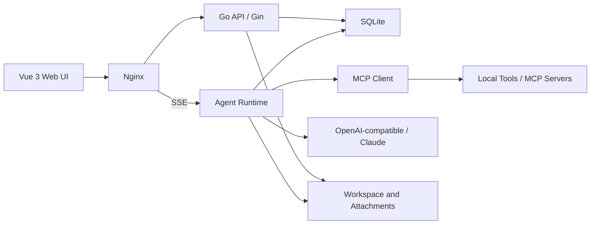
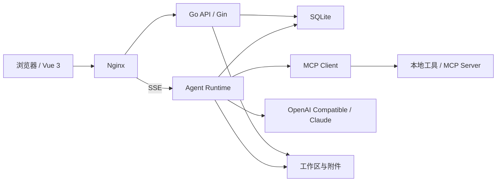
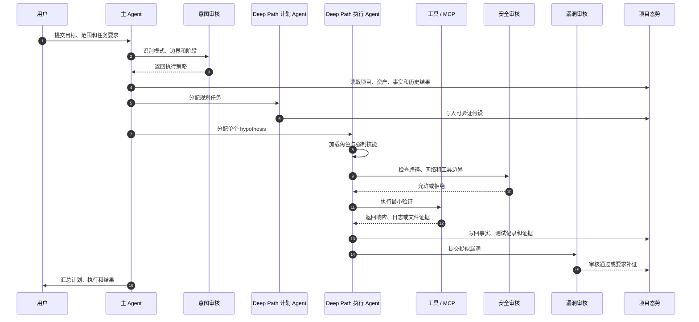
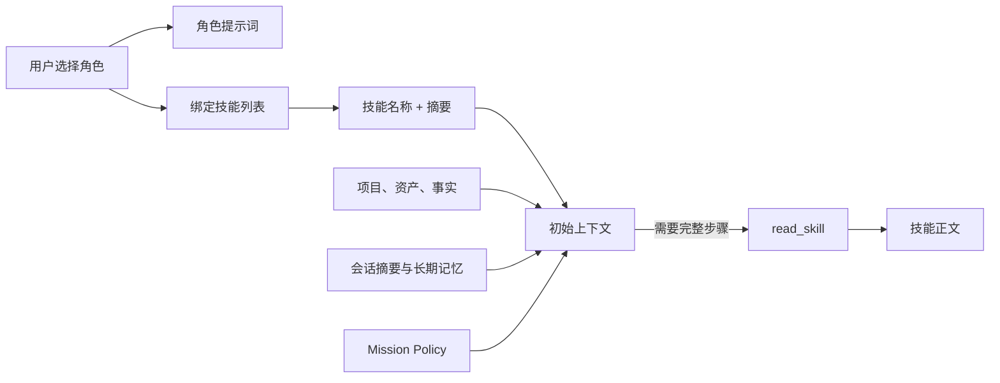
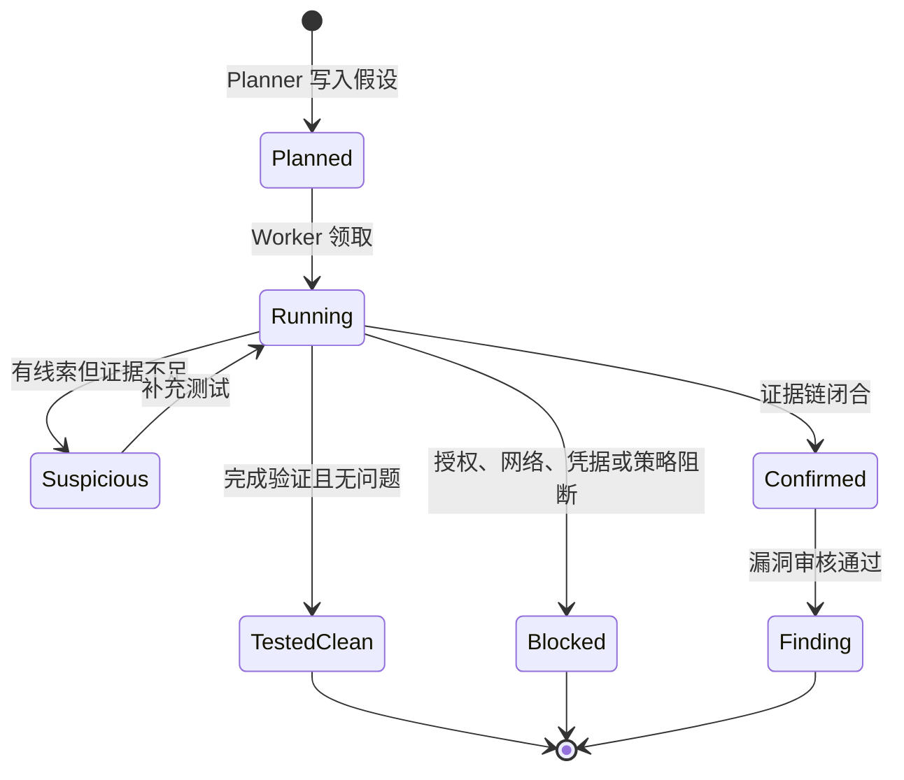
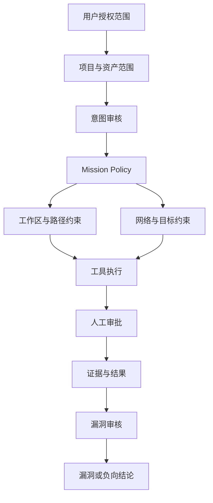

<div align="center">
  
  <h1>Sophon</h1>
  <p><strong>面向授权安全测试的智能 Agent 工作台</strong></p>

  
  
  
  


</div>

**[English](#english) | [简体中文](#简体中文)**

> [!WARNING]
> Sophon is intended only for authorized security testing, code review, and defensive exercises. Users must ensure that targets, time windows, scope, and data handling are explicitly authorized.
>
> Sophon 仅用于已获得明确授权的安全测试、代码审计和攻防演练。使用者必须确保目标、时间窗口、测试边界和数据范围均已获得合法授权。

## English

Sophon is a security Agent workbench that combines authorized security testing tools, roles, skills, project context, evidence, vulnerability review, and multi-Agent coordination in one platform.

It is designed to make every test scoped, traceable, evidence-backed, reviewable, and auditable instead of letting a model run unbounded scans.

### Highlights

- **Single and multi-Agent execution:** main Agent, Planner, Worker, and restricted sub-Agent workflows.
- **Roles, skills, and policy:** roles define intent, skills provide methods, and Mission Policy constrains paths, targets, tools, and approvals.
- **Evidence-driven findings:** findings can reference tool output, requests and responses, source locations, and reproducible steps.
- **Project context:** projects, assets, facts, hypotheses, test records, vulnerabilities, conversations, and attack graphs stay connected.
- **MCP and local tools:** manage MCP servers, tool allowlists, YAML tool definitions, and tools resolved through the local command environment.
- **Code review:** built-in roles and skills for Java, PHP, .NET, binary analysis, and mobile reverse engineering.
- **Vulnerability governance:** review, severity, retest, cleanup records, and report export.
- **Workspace editing:** browse Agent workspaces, preview images, edit UTF-8 text up to 1 MiB, and protect saves with version checks.
- **Security and audit:** RBAC, CSRF protection, HttpOnly sessions, human approval, audit logs, tool execution records, and resource limits.
- **Bilingual UI:** Simplified Chinese and English with light and dark themes.

### Architecture



| Layer | Technology |
|---|---|
| Frontend | Vue 3, TypeScript, Pinia, Vue Router, Vite, Vue Flow |
| Backend | Go 1.25+, Gin, Eino, SQLite |
| Agent | Eino ADK, tool registry, skill loading, context compaction |
| Tools | Built-in tools, YAML tools, restricted runners, MCP |
| Gateway | Nginx static hosting, API proxy, SSE |
| Storage | SQLite, local workspaces, attachments, artifacts |
| Deployment | Docker Compose, host installer, new-container installer |

### Workspace File Editing

The Workspace page supports:

- Directory browsing and file search.
- UTF-8 text preview and editing for the Agent workspace.
- Image preview and binary download.
- `Ctrl/Cmd+S`, dirty-state prompts, reload, and download actions.
- SHA256 version checks to reject stale overwrites.
- Atomic replacement while preserving the original file mode.
- CRLF/LF preservation.
- Read-only behavior for internal caches and uploaded attachments.

Text editing is limited to files up to 1 MiB. File content is not written to the audit log; only the category, path, result, and operation metadata are recorded.

### Requirements

#### Docker

- Docker 24+
- Docker Compose v2
- 4 CPU cores and 8 GB RAM recommended
- `NET_RAW` capability for tools that require raw sockets

#### Local development

- Go 1.25+
- Node.js 20+
- pnpm 9+
- SQLite 3
- An OpenAI-compatible model endpoint or the built-in mock mode

### Quick Start

#### Docker Compose

```bash
cp deploy/.env.example deploy/.env
cp config.example.yml config.yml
```

Set a strong administrator password and model credentials in `deploy/.env` and `config.yml`, then run:

```bash
chmod +x scripts/compose-up.sh scripts/compose-down.sh
./scripts/compose-up.sh
```

Open `http://127.0.0.1:8080/`.

#### Create a new Docker container

`install-docker.sh` pulls a public Kali base image, creates a new container, installs dependencies, builds Sophon, optionally imports user-supplied tools, and starts the service:

```bash
./install-docker.sh
```

The default container is `sophon`, the host port is `8080`, and persistent data is stored in `~/.sophon/docker`.

Slow-network deployments can select mirrors:

```bash
./install-docker.sh \
  --image docker.m.daocloud.io/kalilinux/kali-rolling:latest \
  --apt-mirror tuna \
  --go-mirror china \
  --npm-registry npmmirror \
  --pip-index tuna
```

Use `./install-docker.sh --dry-run` to inspect the plan without pulling images or creating containers.

#### Host installation

```bash
sudo ./install.sh
```

The installer waits for transient `apt/dpkg` locks held by unattended upgrades instead of removing lock files. Go downloads automatically fall back through official and China mirrors:

```bash
sudo ./install.sh --go-mirror auto
sudo ./install.sh --go-mirror ustc
```

#### Source mode

```bash
cp config.example.yml config.yml
cd backend
SOPHON_CONFIG=../config.yml go run ./cmd/server
```

In another terminal:

```bash
cd frontend
pnpm install
pnpm run dev
```

The frontend is available at `http://127.0.0.1:5173`; Vite proxies `/api` to `http://127.0.0.1:18080`.

### Configuration

Configuration precedence:

```text
defaults < config.yml < environment variables
```

Common environment variables:

| Variable | Purpose |
|---|---|
| `SOPHON_CONFIG` | Configuration file path |
| `SOPHON_HOST` | Backend listen address |
| `SOPHON_PORT` | Backend port, default `18080` |
| `SOPHON_DATA_DIR` | SQLite and runtime data |
| `SOPHON_SKILLS_DIR` | Skills directory |
| `SOPHON_ROLES_DIR` | Roles directory |
| `SOPHON_ADMIN_USERNAME` | Bootstrap administrator username |
| `SOPHON_ADMIN_PASSWORD` | Bootstrap administrator password |
| `SOPHON_COOKIE_SECURE` | Set to `true` behind HTTPS |
| `SOPHON_AGENT_MOCK` | Enable mock Agent mode |
| `SOPHON_LLM_BASE_URL` | OpenAI-compatible endpoint |
| `SOPHON_LLM_API_KEY` | LLM API key |
| `SOPHON_LLM_MODEL` | Model name |
| `SOPHON_LLM_ALLOW_PRIVATE_NETWORK` | Allow private model endpoints |
| `SOPHON_EMBEDDING_BASE_URL` | Embedding endpoint |
| `SOPHON_EMBEDDING_API_KEY` | Embedding API key |
| `SOPHON_HITL_ENABLED` | Enable human approval |
| `SOPHON_PROXY_ENABLED` | Enable the outbound proxy |

See [`config.example.yml`](./config.example.yml) for the complete template.

### Main API

| Area | Examples |
|---|---|
| Health | `GET /api/health`, `GET /livez`, `GET /readyz` |
| Authentication | `POST /api/auth/login`, `GET /api/auth/me` |
| Projects | `/api/projects`, `/api/projects/:id/facts` |
| Assets | `/api/assets`, `/api/projects/:id/assets` |
| Vulnerabilities | `/api/vulnerabilities`, `/api/vulnerabilities/:id/retest` |
| Conversations | `/api/conversations`, `/api/chat/stream` |
| Roles and skills | `/api/agent-roles`, `/api/skills` |
| MCP | `/api/mcp/servers`, `/api/mcp/tools`, `/api/mcp/tools/doctor` |
| Workspace | `/api/workspace/list`, `/api/workspace/content`, `/api/workspace/download` |
| Audit | `/api/audit/logs`, `/api/monitor/executions` |

All write APIs require a CSRF token. The Web UI handles it automatically; external clients must read the `sophon_csrf` cookie and send `X-CSRF-Token`.

### Project Layout

```text
.
├── backend/                 Go API, Agent runtime, tools, database
├── frontend/                Vue 3 application
├── deploy/                  Nginx, Compose, container scripts
├── roles/                   Role definitions
├── skills/                  Security skills and references
├── tools/                   YAML tool definitions
├── mcp-servers/             Optional MCP services
├── licenses/                Third-party license notices
├── scripts/                 Deployment and smoke tests
├── config.example.yml       Safe configuration template
├── install.sh               Host installer
├── install-docker.sh        New-container installer
└── README.md                Bilingual documentation
```

`config.yml`, `deploy/.env`, `data/`, `tmp/`, SQLite databases, workspaces, attachments, logs, screenshots with real data, and local build artifacts must not be committed.

### Testing

```bash
cd backend
go test ./... -count=1
go vet ./...

cd ../frontend
pnpm run typecheck
pnpm run build
```

### Security

- Sophon may be used only for systems owned, operated, or controlled by the user's organization, or for security testing, code review, and defensive exercises performed with explicit written authorization from the target owner.
- Before testing, users must confirm the authorization authority, target scope, time window, permitted techniques, data handling rules, and emergency contacts. Access, scanning, exploitation, disruption, collection, or retention beyond the written authorization is strictly prohibited.
- Users bear full responsibility for all actions and consequences resulting from their use of Sophon. To the maximum extent permitted by law, the project authors, contributors, and maintainers disclaim all liability for misuse, unauthorized testing, illegal activity, configuration errors, tool defects, model output, data disclosure, business interruption, property damage, or third-party claims.
- This statement is not legal advice and does not replace a formal authorization document or professional legal guidance.
- Change the bootstrap administrator password immediately.
- Use HTTPS and set `SOPHON_COOKIE_SECURE=true` in production.
- Keep the service behind an authenticated reverse proxy or private network.
- Rotate model and Embedding API keys regularly.
- Review MCP servers and high-risk tools before enabling them.
- Treat workspaces, attachments, tool output, and vulnerability evidence as sensitive data.

Sophon does not guarantee complete vulnerability coverage, and model output must be reviewed by qualified personnel before it is used in a report or remediation decision.

### License

This repository does not include a project-level `LICENSE` file. All rights are reserved unless the copyright owner grants written permission. Third-party tools and dependencies remain under their respective licenses.

## 简体中文

## 项目简介

Sophon 是一个将安全测试工具、角色、技能、项目上下文和多 Agent 协作整合到同一工作台的安全 Agent 平台。它支持从项目建模、资产梳理、测试假设规划、工具执行、证据收集，到漏洞审核和报告输出的完整工作流。

平台提供两种工作模式：

* **单 Agent 模式**：直接使用当前选择的角色、系统提示词、技能和项目上下文执行任务。

* **多 Agent 协调模式**：主 Agent 负责理解目标和调度，规划 Agent 生成可验证假设，执行 Agent 在受限范围内完成测试并写回证据。

Sophon 的目标不是简单地让模型连续调用扫描器，而是让每次测试都有范围、有依据、有证据、有审核、有记录。

## 为什么是 Sophon

### 从“调用工具”到“推进任务”

普通安全 Agent 往往把扫描器输出直接交给模型，再由模型自由决定下一步。Sophon 将任务拆成项目态势、测试假设、最小验证、证据写回和结果审核几个明确阶段，让模型围绕可验证目标推进，而不是进行无边界扫描。

### 从“单个提示词”到“角色、技能和边界”

角色定义身份和业务方向，技能提供方法和检查清单，Mission Policy 约束路径和网络边界，漏洞审核 Agent 负责拦截低质量结果。四者共同决定 Agent 能做什么、应该怎么做、做到什么程度停止。

### 从“聊天记录”到“可复核证据”

每一次测试都可以关联项目、资产、事实、假设、工具输出、请求响应和漏洞。过程详情记录主 Agent、Planner 和 Worker 的实际分工，便于确认 Worker 是否真正执行、调用了哪些技能、产生了哪些证据。

### 从“黑盒结果”到“可审计运行”

平台记录登录、工具调用、人工审批、Agent 状态、Token 用量和系统资源。Worker 受独立工时、工具次数、CPU 和进程预算约束，长任务通过受控 Job 运行并支持恢复与取消。

## 核心能力

| 能力         | 说明                                                 |
| ---------- | -------------------------------------------------- |
| 多 Agent 协调 | 主 Agent、规划 Agent、执行 Worker 分工，支持独立工作区、预算、状态追踪和过程审计 |
| 角色与技能      | 角色定义身份、边界和技能集合；模型按需通过 `read_skill` 加载完整技能正文        |
| 系统 Agent   | 意图审核、安全审核、漏洞审核，以及 Deep Path 计划、执行和子 Agent          |
| 项目上下文      | 项目、资产、事实、测试假设、测试记录、漏洞、攻击路径和会话统一关联                  |
| 证据驱动测试     | 要求引用真实工具输出、请求响应、文件位置或可复现步骤，减少仅凭版本和参数名确认漏洞          |
| 安全边界       | Mission Policy、工作区路径约束、项目资产范围、人工审批、工具预算和进程预算       |
| MCP 与工具    | 管理 MCP 服务、工具白名单、内置工具和文件型工具定义                       |
| 代码审计       | 提供 Java、PHP、.NET 和 App 逆向等角色及专项技能                  |
| 漏洞治理       | 漏洞审核、严重度管理、复测、导出和标准报告工作流                           |
| 审计与可观测性    | 登录审计、工具执行记录、Agent 运行状态、Token 统计和应用指标               |
| 多用户与 RBAC  | 用户、角色、路由级权限、会话安全和 CSRF 防护                          |
| 中英文界面      | 内置简体中文与英文界面，可切换明暗主题                                |

## 功能模块

| 页面     | 主要功能                                       |
| ------ | ------------------------------------------ |
| 仪表盘    | 安全运营概览、资产与漏洞统计、系统资源和流水线状态                  |
| 对话     | 单 Agent 与多 Agent 协调、角色选择、项目绑定、附件、过程追踪和提问导航 |
| 项目管理   | 项目生命周期、目标与范围、批量会话启动、Token 统计和项目态势          |
| 资产管理   | 资产清单、业务系统、重要度、状态和项目关联                      |
| 漏洞管理   | 漏洞筛选、严重度分布、审核、复测、导出和批量操作                   |
| 角色管理   | 角色提示词、默认模式、技能绑定、启用状态和系统 Agent 查看           |
| 技能管理   | 技能搜索、编辑、标签和角色绑定                            |
| MCP 管理 | MCP 服务启停、连接测试、工具发现和工具授权                    |
| 审计监控   | 登录、治理、工具调用、审批和运行指标                         |
| 工作空间   | Agent 产物、会话文件、分类浏览、文本在线编辑、图片预览、下载和清理       |
| 用户与权限  | 用户管理、RBAC 角色和权限矩阵                          |
| 系统设置   | 模型、Embedding、代理、人工审批、存储清理和个人资料             |

## 典型使用场景

| 场景                     | 工作方式                                          |
| ---------------------- | --------------------------------------------- |
| Web 渗透测试               | 建立项目与资产，选择渗透测试角色，由 Planner 生成假设、Worker 执行最小验证 |
| Java / PHP / .NET 代码审计 | 选择语言角色，加载路由、鉴权、数据流、文件操作和利用链专项技能               |
| App 逆向                 | 分析本地 APK、协议、Native 层和风险点，所有文件操作限制在工作区         |
| 云安全审计                  | 结合云资产、配置和授权边界，生成可验证的云环境风险假设                   |
| 后渗透与横向分析               | 在明确授权和审批下分析凭据复用、横向路径和权限边界                     |
| 漏洞复测                   | 基于原始证据创建独立复测会话，记录仍可复现、已修复或无法确认                |
| 内部安全运营                 | 通过 RBAC、审计监控、工作空间和存储治理管理多人协作                  |

## 系统架构




| 组件    | 技术                                              |
| ----- | ----------------------------------------------- |
| 前端    | Vue 3、TypeScript、Pinia、Vue Router、Vite、Vue Flow |
| 后端    | Go 1.25、Gin、Eino、SQLite                         |
| Agent | Eino ADK、工具注册、技能加载、上下文压缩和过程追踪                   |
| 工具层   | 内置工具、YAML 工具定义、受限执行器和 MCP                       |
| 网关    | Nginx，负责静态资源、API 反向代理和流式响应                      |
| 存储    | SQLite、本地会话工作区、附件和工具产物                          |
| 部署    | Docker Compose 或现有容器部署脚本                        |

## 项目结构

```text
.
├── backend/                 Go API、Agent、工具执行器和数据库
├── frontend/                Vue 3 Web 界面
├── deploy/
│   ├── container/           容器内启动、停止和权限配置
│   ├── nginx/               Nginx 配置
│   └── docker-compose.yml   Compose 部署
├── roles/                   角色 YAML
├── skills/                  技能正文与参考资料
├── tools/                   文件型工具定义
├── mcp-servers/             可选 MCP 服务
├── licenses/                第三方许可证
├── scripts/                 部署与冒烟测试脚本
├── config.example.yml       配置模板
└── README.md
```


`config.yml`、`data/`、`tmp/`、会话工作区、数据库和日志均属于本地运行数据，不应提交到 GitHub。

## 部署方式

| 方式             | 适用场景                   |
| -------------- | ---------------------- |
| Docker Compose | 推荐方式，适合单机部署和内部环境       |
| 源码运行           | 开发、调试和自定义构建            |
| 现有容器部署         | 将后端、前端和配置同步到已经准备好的工具容器 |

生产部署建议使用独立数据卷或宿主机目录持久化数据库、附件、工作区和工具产物，并定期备份。

## 环境要求

### Docker 部署

* Docker 24+

* Docker Compose v2

* 建议至少 4 核 CPU、8 GB 内存

* 需要执行扫描类工具时，根据工具要求配置 `NET_RAW` 等容器能力

### 本地开发

* Go 1.25+

* Node.js 20+

* pnpm 9+

* SQLite 3

* 可访问的 LLM API，或使用内置 Mock 模式

## Docker Compose 部署

1. 创建环境变量文件：

```bash
cp deploy/.env.example deploy/.env
```


1. 修改 `deploy/.env`：

```dotenv
SOPHON_HTTP_PORT=8080
SOPHON_ADMIN_PASSWORD=请设置强密码
SOPHON_LLM_API_KEY=
SOPHON_EMBEDDING_API_KEY=
```


1. 创建配置：

```bash
cp config.example.yml config.yml
```


1. 编辑 `config.yml` 中的模型、Embedding、代理和人工审批设置。

2. 启动：

```bash
chmod +x scripts/compose-up.sh scripts/compose-down.sh
./scripts/compose-up.sh
```


默认访问地址：

```text
http://127.0.0.1:8080/
```

主机直装可使用：

```bash
sudo ./install.sh
sudo ./install.sh --go-mirror auto
```

安装器会等待 `unattended-upgrades` 临时持有的 apt/dpkg 锁，不会删除锁文件；Go 下载支持官方、中国镜像、USTC 和阿里云自动回退。


停止服务：

```bash
./scripts/compose-down.sh
```


数据保存在 Compose 命名卷 `sophon-data` 中，停止容器不会删除数据。

> [!IMPORTANT]  
> 镜像只包含后端二进制和前端静态资源。角色、技能和工具定义属于平台文件资源；`thirdTools/` 不随 Git 发布包提供，平台通过本地命令环境调用工具，用户可按需上传可信二进制到运行目录或自行安装到系统 `PATH`。工具缺失只会使对应 MCP 工具不可用，不影响平台启动。

需要在 Compose 中启用完整文件资源时，可增加 override：

```yaml
services:
  backend:
    volumes:
      - ../roles:/opt/sophon/roles:ro
      - ../skills:/data/skills:ro
      - ../tools:/opt/sophon/tools:ro
      # 仅当用户自行准备了 thirdTools 时启用
      - ../thirdTools:/opt/sophon/thirdTools:ro
```


## 升级与备份

升级前至少备份：

* SQLite 数据库及其 `-wal`、`-shm` 文件

* 会话工作区和附件目录

* `config.yml`

* 自定义角色、技能、工具和 MCP 配置

源码部署升级：

```bash
./scripts/compose-down.sh
# 备份数据目录和 config.yml
git pull
./scripts/compose-up.sh
```


后端启动时会执行幂等数据库迁移。迁移只保证结构升级，不回退历史数据，因此升级前必须保留可恢复备份。

> [!NOTE]  
> 当前版本不提供页面内一键升级。生产环境应通过固定的发布版本、镜像标签或部署流水线升级，不要在运行中的容器里直接覆盖未知来源的二进制。

## 本地开发

### 1. 启动后端

```bash
cp config.example.yml config.yml
cd backend
SOPHON_CONFIG=../config.yml go run ./cmd/server
```


默认监听：

```text
http://127.0.0.1:18080
```


健康检查：

```bash
curl http://127.0.0.1:18080/api/health
```


### 2. 启动前端

```bash
cd frontend
pnpm install
pnpm run dev
```


开发服务器：

```text
http://127.0.0.1:5173
```


Vite 会把 `/api` 代理到 `127.0.0.1:18080`。

### 3. 首次登录

* 默认管理员用户名由 `auth.bootstrap_admin.username` 或 `SOPHON_ADMIN_USERNAME` 决定。

* 初始密码来自 `auth.bootstrap_admin.password`、`SOPHON_ADMIN_PASSWORD` 或自动生成的密码文件。

* 自动生成的密码文件位于数据目录下的 `bootstrap_admin_password.txt`。

* 首次登录后应立即修改密码并删除初始密码文件。

## 配置说明

配置优先级：

```text
程序默认值 < config.yml < 环境变量
```


空的或未设置的环境变量不会覆盖配置文件。

配置文件查找顺序：

```text
1. SOPHON_CONFIG 指定路径
2. 当前工作目录的 config.yml
3. /opt/sophon/config.yml
```


常用环境变量：

| 变量                                 | 说明                  |
| ---------------------------------- | ------------------- |
| `SOPHON_CONFIG`                    | 配置文件路径              |
| `SOPHON_HOST`                      | 后端监听地址              |
| `SOPHON_PORT`                      | 后端监听端口，默认 `18080`   |
| `SOPHON_DATA_DIR`                  | 数据库、附件和工作区根目录       |
| `SOPHON_SKILLS_DIR`                | 技能目录                |
| `SOPHON_ROLES_DIR`                 | 角色目录                |
| `SOPHON_ADMIN_USERNAME`            | 初始管理员用户名            |
| `SOPHON_ADMIN_PASSWORD`            | 初始管理员密码             |
| `SOPHON_COOKIE_SECURE`             | HTTPS 环境应设置为 `true` |
| `SOPHON_AGENT_MOCK`                | 是否使用 Mock Agent     |
| `SOPHON_LLM_BASE_URL`              | OpenAI 兼容 API 地址    |
| `SOPHON_LLM_API_KEY`               | LLM API Key         |
| `SOPHON_LLM_MODEL`                 | LLM 模型名             |
| `SOPHON_LLM_ALLOW_PRIVATE_NETWORK` | 是否允许访问私网模型地址        |
| `SOPHON_EMBEDDING_BASE_URL`        | Embedding API 地址    |
| `SOPHON_EMBEDDING_API_KEY`         | Embedding API Key   |
| `SOPHON_HITL_ENABLED`              | 是否启用人工审批            |
| `SOPHON_PROXY_ENABLED`             | 是否启用平台出网代理          |

完整配置项见 [`config.example.yml`](./config.example.yml)。

### LLM 配置示例

```yaml
agent:
  mock: false
  llm:
    base_url: https://api.deepseek.com/v1
    api_key: ""
    model: deepseek-chat
    timeout_seconds: 120
```


建议通过环境变量或本地未提交的 `config.yml` 提供密钥，不要将真实密钥写入 README、Issue、截图或提交记录。

### 私网模型

默认禁止 LLM 访问私网地址。使用本地 Ollama、vLLM 或其他私网模型时，需要显式开启：

```yaml
agent:
  llm:
    allow_private_network: true
```


同时应限制服务暴露范围，并为模型服务配置认证或网络隔离。

## Agent 工作模式

### 单 Agent 模式

单 Agent 模式直接使用当前角色和技能执行任务，适合：

* 单一目标验证

* 快速代码审计

* 明确命令或分析任务

* 需要连续上下文的小范围工作

### 多 Agent 协调模式

多 Agent 协调模式将任务拆分给不同职责的 Agent：

| Agent              | 职责                                   |
| ------------------ | ------------------------------------ |
| 主 Agent            | 理解用户目标、选择阶段、调度 Planner 和 Worker、汇总结果 |
| Deep Path 计划 Agent | 读取项目态势，生成可验证假设，不直接执行测试               |
| Deep Path 执行 Agent | 围绕单个假设执行最小验证，收集并写回证据                 |
| Deep Path 子 Agent  | 在更小范围内完成指定分析或验证                      |

Planner 和 Worker 会继承当前用户选择的角色和技能，但会被重新限定为当前任务的专属身份，避免扩大范围。

### 多 Agent 协调链路




### 技能与上下文注入

Sophon 不会在每轮对话中无差别加载所有技能正文。默认只注入角色提示词、技能名称、技能摘要和目录位置；当模型明确需要完整步骤时，再通过 `read_skill` 加载正文。




多 Agent 模式会对当前角色重新封装 Planner 和 Worker 的任务身份。角色提供业务能力和技能集合，系统 Agent 提供安全边界、审核和规划约束，两者不会互相覆盖。

### 项目态势与假设生命周期




每个假设至少关联资产、测试维度、技术、规划依据、预期证据和优先级。Worker 不得修改其他假设，也不能因为项目中还存在其他资产而自行扩大范围。

### Worker 预算与受控执行

| 限制        | 行为                                              |
| --------- | ----------------------------------------------- |
| 最大实际耗时    | 超时后终止 Worker 及其进程组                              |
| 最大工具次数    | 达到预算后停止继续调用                                     |
| 最大 CPU 秒数 | 限制受限进程组累计 CPU 消耗                                |
| 最大进程数     | 防止进程数量失控                                        |
| 工作区边界     | 仅允许会话工作区、授权源码目录或 App 包范围                        |
| 后台任务      | 必须通过受控 Job，禁止 `nohup`、`setsid`、`disown` 和后台 `&` |

## Agent 生命周期

一次完整任务通常经过以下阶段：

1. **目标识别**：主 Agent 结合用户输入、角色和项目范围确定任务模式。
2. **安全审核**：确认目标属于授权资产，确认工作区和网络边界。
3. **态势读取**：加载项目事实、资产、漏洞、历史假设和最近执行记录。
4. **规划**：Planner 生成可验证假设，明确预期证据和优先级。
5. **执行**：Worker 领取单个假设，加载技能并执行最小验证。
6. **证据写回**：记录工具输出、响应差异、文件位置和测试结论。
7. **漏洞审核**：检查复现证据、可利用性和实际安全影响。
8. **收敛**：没有新的高价值方向时停止，不进行无边界扫描。
9. **审计**：保留过程、Token、资源消耗和审批记录。

## 系统 Agent

| 系统 Agent           | 作用                     |
| ------------------ | ---------------------- |
| 意图审核               | 识别任务模式、授权范围、阶段顺序和工具边界  |
| 安全审核               | 约束工作区路径、敏感目录、网络授权和失败重试 |
| 漏洞审核               | 在漏洞写入前检查证据、可复现性和实际安全影响 |
| Deep Path 计划 Agent | 把项目状态转化为结构化测试假设        |
| Deep Path 执行 Agent | 执行单个已验证假设并完成状态写回       |
| Deep Path 子 Agent  | 执行受限的子任务               |

系统 Agent 用于保障平台行为一致性，不等同于用户业务角色。

## 角色与技能

角色位于 `roles/`，通过 YAML 定义：

```yaml
name: 示例角色
description: 角色说明
default_mode: auto
skills:
  - example-skill
prompt: |
  角色系统提示词
```


内置角色覆盖：

* 默认

* 渗透测试

* 后渗透测试

* CTF

* 云安全审计

* 二进制分析

* App 逆向

* Java 代码审计

* PHP 代码审计

* .NET 代码审计

技能位于 `skills/<name>/SKILL.md`。平台先向模型提供技能名称、摘要和目录，需要完整内容时再通过只读工具 `read_skill` 加载正文。

维护技能时应注意：

* 明确适用场景和停止条件。

* 明确只读、可写、网络和工具边界。

* 对上传、反序列化、鉴权、SSRF 等高风险方向给出证据标准。

* 禁止在技能中写入真实凭据、内部目标或不可公开的个人信息。

## 工具与 MCP

工具来源包括：

* 平台内置工具

* `tools/*.yaml` 文件型工具

* 受限 Shell 和 Python 执行器

* MCP stdio 或远程服务

* 用户通过 MCP 管理页面添加的外部工具

工具执行受以下机制约束：

* 项目授权范围和资产范围

* Mission Policy 路径与命令检查

* 工具白名单和角色技能约束

* 人工审批

* 单次调用超时

* 并发限制

* Worker 工具次数、耗时、CPU 和进程预算

* 后台任务 Job ID、进度、恢复点和会话取消联动

MCP 服务在“MCP 管理”中配置和测试。新增外部 MCP 服务前，应检查其权限、网络访问、命令执行能力和数据外传风险。

## 项目与漏洞工作流

推荐工作流：

1. 创建项目并填写授权范围、目标、时间窗口和限制。
2. 添加资产，绑定业务系统和重要度。
3. 选择角色、技能和 Agent 模式。
4. 主 Agent 读取项目事实与资产，识别测试缺口。
5. Planner 生成可验证假设。
6. Worker 使用最小请求或最小分析步骤验证假设。
7. 记录工具输出、请求响应、IL/源码位置或复现步骤。
8. 漏洞审核 Agent 检查证据和实际影响。
9. 将确认问题写入漏洞管理并执行复测。
10. 导出报告并保留必要的审计记录。

漏洞报告建议包含：

* 系统基本情况

* 漏洞概述

* 完整复现步骤

* PoC 或请求数据包

* 实际证据

* 分层危害分析

* 可落地修复方案

* 测试残留说明

## 安全边界




Sophon 默认采用以下安全策略：

* 文件操作限制在会话工作区、授权源码目录或 App 包范围内。

* 禁止使用系统根目录和未授权绝对路径作为输出目录。

* 禁止通过 `../`、`$HOME`、`/etc`、`/proc` 等方式逃逸工作区。

* 只对项目授权资产执行网络请求。

* 高风险工具需要人工审批。

* 不允许通过 `nohup`、`setsid`、`disown` 或后台 `&` 绕过受控任务。

* 长任务必须通过 Job 执行，支持进度、恢复、去重和取消。

* 工具参数落库前会对密码、Token、Secret 和 API Key 等字段脱敏。

安全策略不能替代使用者自己的授权管理。生产环境还应：

* 使用 HTTPS，并设置 `SOPHON_COOKIE_SECURE=true`。

* 修改默认管理员密码。

* 将服务置于受控反向代理和访问控制之后。

* 不要把 Sophon 直接暴露到公网。

* 定期轮换模型 API Key。

* 限制附件、工作区和数据库目录权限。

* 定期审查审计日志、MCP 服务和高风险工具。

### 权限与数据保护

* 用户密码使用 bcrypt 哈希保存。

* Session 使用 HttpOnly Cookie，写请求校验 CSRF Token。

* 外部脚本调用写接口时必须携带 `X-CSRF-Token`。

* 审计日志和工具执行记录按用户隔离。

* 附件、工作区下载和删除接口均经过所有权或权限检查。

* 敏感工具参数在审计记录中脱敏，但审批记录会为人工判断保留必要上下文。

## 多用户与权限

内置权限模型：

| RBAC 角色    | 说明        |
| ---------- | --------- |
| `admin`    | 全部权限      |
| `operator` | 日常测试和业务写入 |
| `viewer`   | 只读访问      |

安全机制包括：

* bcrypt 密码哈希

* HttpOnly Session Cookie

* 写请求 CSRF Token 校验

* 登录失败限流

* 路由级权限中间件

* 审计日志

* 会话过期和最近访问时间

所有写请求需要携带 CSRF Token。Web 前端会自动处理；外部脚本调用 API 时需要读取 `sophon_csrf` Cookie 并发送 `X-CSRF-Token` 请求头。


## 测试与构建

### 后端

```bash
cd backend
go test ./... -count=1
go vet ./...
go build ./...
```


### 前端

```bash
cd frontend
pnpm run typecheck
pnpm run build
```


### 生产前端

构建结果位于 `frontend/dist/`，由 Nginx 托管。

## 常见问题

### 为什么技能页面为空？

检查 `SOPHON_SKILLS_DIR` 或 `server.skills_dir` 是否指向正确目录，并确认目录中包含 `<skill-name>/SKILL.md`。

### 为什么角色没有同步？

检查 `SOPHON_ROLES_DIR` 或 `server.roles_dir`，以及 YAML 格式是否正确。启动日志会输出角色同步数量。

### 为什么模型调用失败？

依次检查：

1. `agent.mock` 是否为 `false`
2. `base_url` 是否可从后端访问
3. API Key 是否有效
4. 模型名是否与服务商一致
5. 私网模型是否开启 `allow_private_network`
6. 平台代理设置是否正确

### 为什么工具没有显示？

检查 `tools/*.yaml`、MCP 服务状态和工具授权配置。MCP 新增后需要执行连接测试和工具发现。

### 为什么 Agent 被安全策略拒绝？

查看过程详情中的 Mission Policy 信息。常见原因包括：

* 使用工作区外绝对路径

* 访问未授权资产

* 尝试后台执行

* 使用禁止的高风险命令

* 未通过人工审批

### SQLite 是否适合生产？

SQLite 适合单实例、中小规模和受控部署。需要高并发写入、多副本或水平扩展时，应评估迁移到独立数据库，并重新设计任务锁和并发控制。

## 贡献

提交 Pull Request 前请确保：

* 变更范围清晰，避免混入无关重构。

* 新行为包含测试或可复现验证步骤。

* 不提交真实目标、凭据、附件和运行数据。

* 新增技能或工具时补充适用边界、依赖和许可证。

* 修改安全策略时说明误报、漏报和绕过风险。

## 安全声明

Sophon 仅允许用于用户所在公司或组织自身拥有、运营或控制的系统，以及已获得目标权利人明确书面授权的安全测试、代码审计和攻防演练。

使用者必须在测试前确认授权主体、目标范围、时间窗口、允许技术、数据处理和应急联系人。任何超出书面授权范围的访问、扫描、利用、破坏、数据获取或留存均被严格禁止。

使用者对使用 Sophon 的全部行为及后果承担全部责任。因用户误用、越权测试、违法使用、配置错误、工具缺陷、模型输出、数据泄露、业务中断、财产损失或第三方索赔造成的任何直接或间接损失，项目作者、贡献者和维护者不承担任何责任。

Sophon 提供的是安全测试辅助能力，不保证发现所有问题，也不保证模型生成的结论天然正确。最终漏洞确认、报告发布和修复建议应由具备相应资质的人员复核。

本声明不构成法律意见，也不替代正式授权文件或专业法律建议。

## 许可证

当前仓库未附带项目级 `LICENSE` 文件，默认保留所有权利。未经版权所有者书面授权，不得复制、分发、修改或商业使用本项目。

随项目使用的技能和依赖遵循各自许可证。`thirdTools/` 不包含在发布包中；用户自行添加第三方工具时，应单独确认其许可证和再分发要求。
